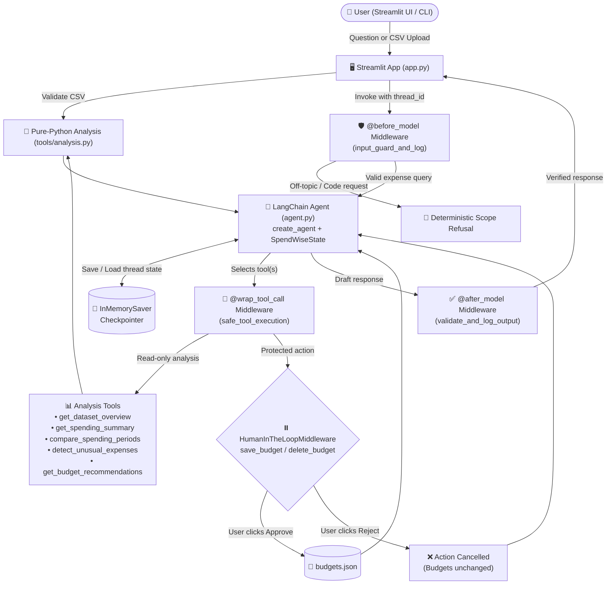
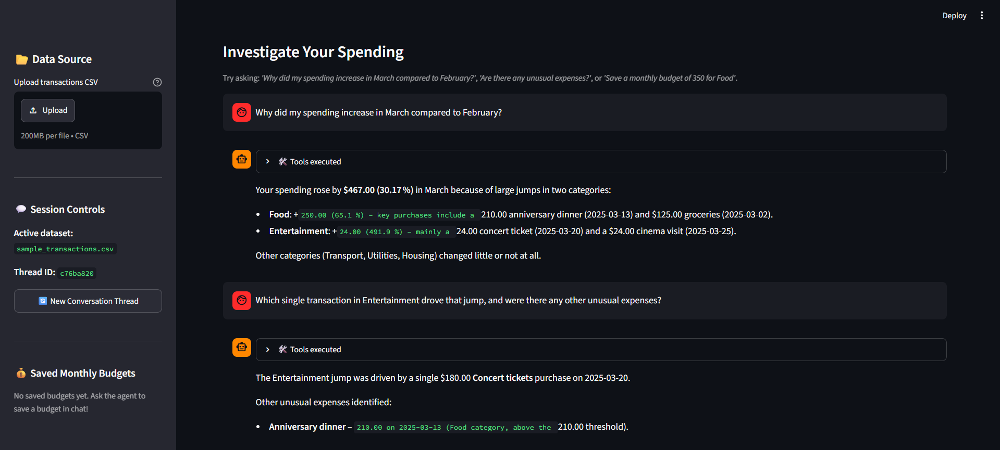
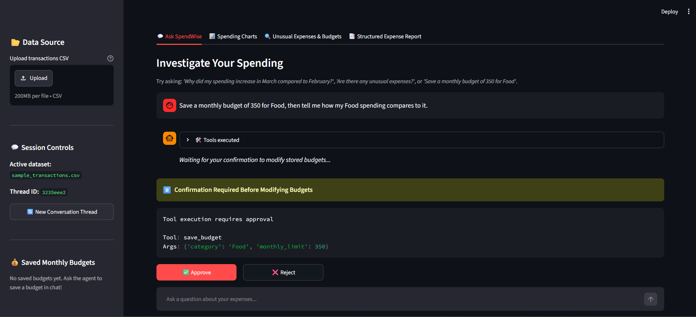
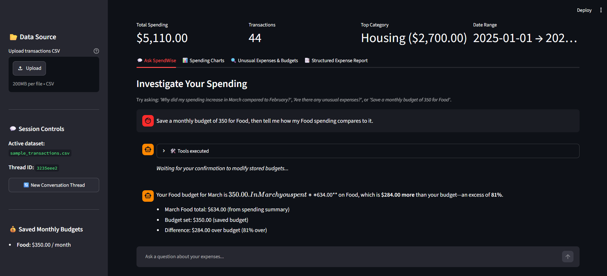
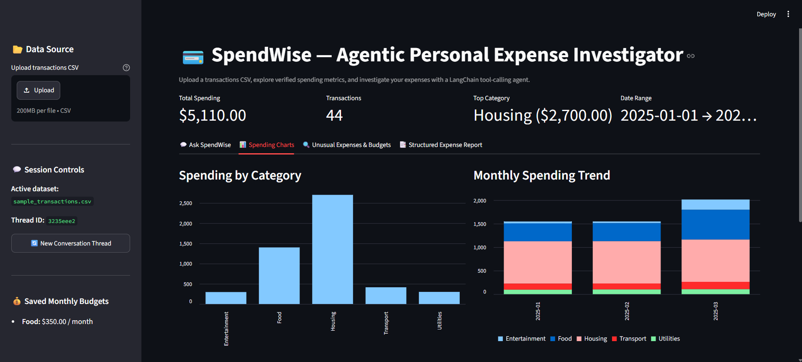
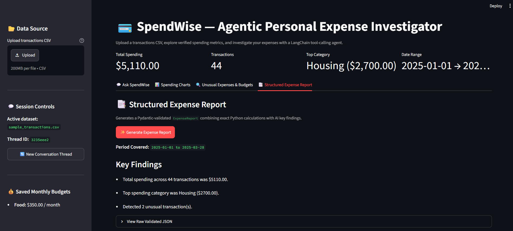

# 💳 SpendWise — Agentic Personal Expense Investigator

**SpendWise** is an AI-powered personal expense analysis assistant built with **LangChain v1**, **LangGraph**, **pandas**, and **Streamlit**.

Instead of relying on an LLM to do math (where models often hallucinate numbers), SpendWise delegates every calculation—spending summaries, period-over-period comparisons, IQR outlier detection, and budget evaluations—to **deterministic Python tools**. The LangChain agent decides *which* tools to call based on natural-language questions, maintains conversational memory across follow-up turns, enforces safety guardrails via middleware, and pauses for **Human-in-the-Loop (HITL)** approval before saving or deleting any budget limit.

---

## ✨ Key Features & LangChain Concepts Applied

| Concept | How SpendWise Uses It |
|---|---|
| **Tool Calling (`@tool`)** | 6 pure-Python pandas functions wrapped as LangChain tools (`get_dataset_overview`, `get_spending_summary`, `compare_spending_periods`, `detect_unusual_expenses`, `get_budget_recommendations`, `save_budget`, `delete_budget`). |
| **State & Conversational Memory** | Uses `InMemorySaver` checkpointer keyed by `thread_id` and a custom `SpendWiseState` schema (`dataset_name`, `last_comparison` updated via `Command`). |
| **Agent Middleware** | • `@before_model` (`input_guard_and_log`): Logs inputs and deterministically blocks off-topic/code/jailbreak prompts.<br>• `@wrap_tool_call` (`safe_tool_execution`): Catches tool errors and returns structured `ToolMessage` feedback.<br>• `@after_model` (`validate_and_log_output`): Sanitizes vendor identity leaks and verifies cited transaction amounts against tool evidence.<br>• `ModelRetryMiddleware`: Exponential backoff retry on free-tier API rate limits (`429`). |
| **Human-in-the-Loop (HITL)** | `HumanInTheLoopMiddleware(interrupt_on={"save_budget": True, "delete_budget": True})` pauses execution and requires explicit user approval (`Approve` / `Reject`) before modifying `budgets.json`. |
| **Structured Output (Pydantic)** | Generates validated `ExpenseReport` objects (`schemas.py`) combining exact Python metrics with AI-synthesized key findings. |

---

## 🏗️ Architecture Diagram



---

## 📸 Screenshots & Walkthrough

### 1. Period Investigation & Conversational Memory
Ask why spending changed between months (`compare_spending_periods`), then ask a natural follow-up question (`"Which single transaction in Entertainment drove that jump, and were there any other unusual expenses?"`). The agent remembers the previous comparison context via its `thread_id` checkpointer and calls `detect_unusual_expenses` to pinpoint the exact outlier transactions (**Concert tickets — $180.00** on `2025-03-20` and **Anniversary dinner — $210.00** on `2025-03-13`).



---

### 2. Human-in-the-Loop (HITL) — Pause Before Modifying Budgets
When asked to *"Save a monthly budget of 350 for Food, then tell me how my Food spending compares to it"*, `HumanInTheLoopMiddleware` intercepts the `save_budget` tool call and pauses the graph until the user explicitly clicks **✅ Approve** or **❌ Reject**.



---

### 3. Human-in-the-Loop — Resumed Execution After Approval
After clicking **✅ Approve**, the budget (`Food: $350.00 / month`) is persisted to `budgets.json` (visible in the left sidebar under **💰 Saved Monthly Budgets**), and the agent automatically resumes to complete the second part of the user's request—comparing March Food spending (`$634.00`) against the newly saved `$350.00` limit (`$284.00` over budget).



---

### 4. Interactive Spending Charts Dashboard
The **📊 Spending Charts** tab renders deterministic visual analytics directly from the validated dataset, including **Spending by Category** and **Monthly Spending Trend** stacked bar charts alongside key metric cards (`$5,110.00` total across `44` transactions from `2025-01-01` to `2025-03-28`).



---

### 5. Structured Expense Report (`ExpenseReport` Schema)
The **📑 Structured Expense Report** tab generates a Pydantic-validated `ExpenseReport` combining exact Python calculations with concise key findings and an expandable raw JSON view.



---

## 📁 Project Structure

```text
spendwise/
├── app.py                      # Phase 6: Streamlit web interface
├── agent.py                    # Phase 3–5: Model, prompt, middleware, HITL, and CLI
├── schemas.py                  # Phase 5: Pydantic schemas for structured ExpenseReport
├── demo.py                     # Phase 1: Standalone CSV validation & summary script
├── data/
│   ├── sample_transactions.csv # Sample Jan–Mar 2025 transaction dataset
│   └── budgets.json            # Local JSON storage for approved monthly budgets
├── tools/
│   ├── analysis.py             # Phase 1–2: Pure-Python pandas calculation functions
│   └── agent_tools.py          # Phase 3–5: LangChain @tool wrappers
├── screenshots/                # Application screenshots
├── requirements.txt            # Python dependencies
└── .env.example                # Example environment variables for free LLM providers
```

---

## 🚀 Getting Started

### 1. Create Virtual Environment & Install Dependencies
```powershell
python -m venv spendwise/.venv
.\spendwise\.venv\Scripts\Activate.ps1
python -m pip install -U -r spendwise/requirements.txt
```

### 2. Configure Your Free LLM API Key
Copy `spendwise/.env.example` to `spendwise/.env` and add your free API key (e.g., from [Groq](https://console.groq.com/keys) or [Google AI Studio](https://aistudio.google.com/apikey)):

```env
MODEL_NAME=groq:llama-3.3-70b-versatile
GROQ_API_KEY=your_groq_api_key_here
```

### 3. Run the Streamlit Web App
```powershell
& "spendwise\.venv\Scripts\python.exe" -m streamlit run spendwise/app.py
```

### 4. (Optional) Run the Interactive Terminal Agent
```powershell
& "spendwise\.venv\Scripts\python.exe" -m spendwise.agent
```

### 5. Run the Automated Test Suite (18 Tests)
```powershell
& "spendwise\.venv\Scripts\python.exe" -m unittest spendwise.tests.test_analysis spendwise.tests.test_memory spendwise.tests.test_phase5 spendwise.tests.test_app -v
```
